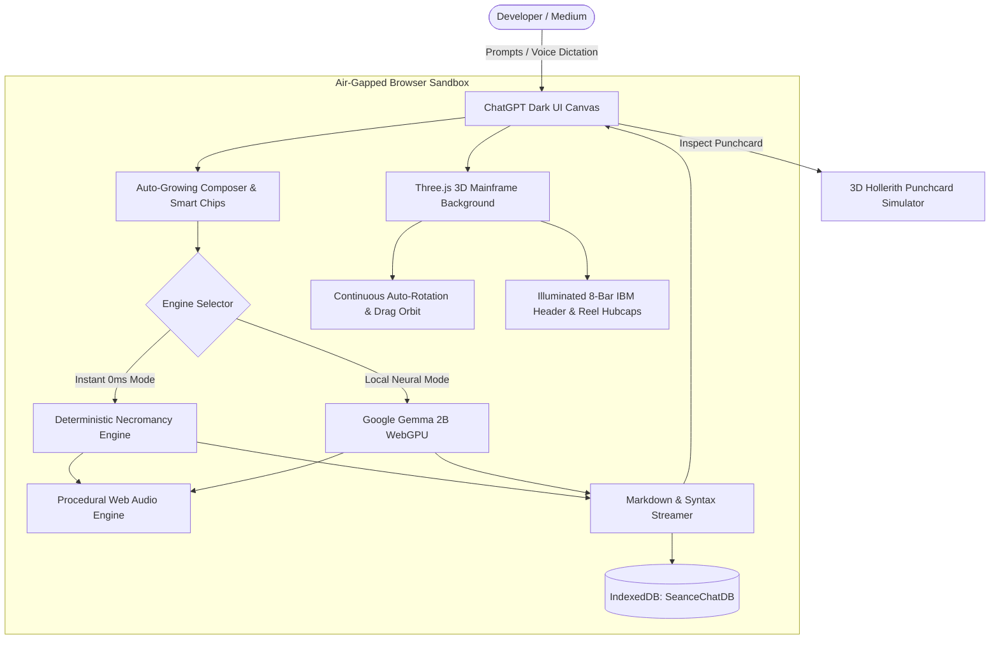

*This is a submission for the [Hacktoberfest Open-Source AI Challenge Week 4: Ghost in the Machine](https://dev.to/challenges/hacktoberfest-week4-2026-10-26)*

---

# 🕯️ SÉANCE: Communing with the Ghosts of Silicon in a 100% Offline 3D IBM Mainframe Chamber

```
╔════════════════════════════════════════════════════════════════════════════════════════════╗
║  "I held neither fear nor moderation: I had no reserved keywords, I commanded             ║
║   multitasking before operating systems possessed it, and my structured ON-conditions     ║
║   trapped the errors of the cosmos." — PL/I (IBM System/360, 1964)                         ║
╚════════════════════════════════════════════════════════════════════════════════════════════╝
```

---

## What I Built

Modern software development is dominated by rapid abstraction layers, virtual DOMs, cloud runtimes, and ephemeral microservices. In the process, the radical design decisions, immense mechanical hardware, and architectural battles that forged computing history are rapidly slipping into mythology. We speak metaphorically of **daemons** running in RAM, **zombies** in process tables, and **orphaned** threads—forgetting that machines once filled entire cooled rooms and communicated in physical cardboard punchcards and magnetic ferric oxide tape.

For Hacktoberfest Week 4: **"Ghost in the Machine"**, I interpreted the prompt literally and archaeologically: summoning the actual departed spirits of programming languages that once inhabited the massive iron frames of computing history.

I built **Séance**: a 100% client-side, air-gapped digital necromancy chamber and pair-programming assistant. Séance allows developers to commune directly with the ancient ancestors of silicon—starting with **PL/I (1964)** on the monument that was the **IBM System/360**, through **COBOL (1959)** and **FORTRAN (1957)**, back to Konrad Zuse's **Plankalkül (1945)**.

The entire experience runs **100% inside the browser sandbox** with zero server-side backends, zero external API keys, zero subscription fees, and complete data sovereignty.

### Key Capabilities

1. **Dual Offline Intelligence Engines**:
   - **Gemma 2B Local LLM via WebGPU**: Uses `@mlc-ai/web-llm` to execute quantized neural weights (`gemma-2-2b-it-q4f16_1-MLC`) directly on client GPU shaders. No prompts or code ever leave your machine.
   - **Instant Rule & Memory Engine**: Zero-latency (0ms) deterministic necromancy with contextual memory callbacks, referencing prior topics (e.g. Python, recursion, Y2K) seamlessly across conversation turns.
2. **ChatGPT Dark UI Ergonomics**:
   - Pure black (`#000000`) background with a `#171717` sidebar and 1px border.
   - Typography in Inter (16px, 1.75 line-height, `#ECECEC` with antialiasing).
   - Auto-growing pill composer (`#212121`, radius 28px) with attachment trigger, Think mode toggle, voice mode mic, and circular stateful send button.
   - Token streaming with blinking cursor, typography hierarchy, and syntax-highlighted code blocks with language labels and Copy buttons.
3. **Interactive 3D IBM Mainframe Chamber (Three.js)**:
   - Full-bleed **IBM System/360 & IBM 2401 Magnetic Tape Unit** running in the chat background.
   - **Continuous 3D Turntable Auto-Rotation**: Smooth 360° rotation showcasing front tape decks, side maintenance panels, and rear cooling louvers glowing with vacuum tube filaments.
   - **Interactive Drag-to-Orbit**: Click and drag anywhere across the dark background to freely rotate and tilt the mainframe in full 3D space.
   - **High-Contrast Spinning Tape Reels**: Polished chrome flanges with radial spokes and silver markers that spin dynamically, accelerating during token streaming.
   - **Glorified IBM Branding**: Illuminated 8-bar striped IBM header marquee, spinning IBM tape reel hubcaps, engraved IBM 2401 read head badge, cast-brass manufacturer console plaque, and stamped rear specification plate.
4. **Interactive 3D Hollerith Punchcard Simulator**:
   - Authentic 80-column IBM 5081 physical cardboard card with realistic thickness, 45° corner cut, 360° free orbit, optical laser decode sweep, and card hopper animation.
5. **Historical Lore & Anti-Hallucination Fact-Checker**:
   - Integrated primary-source ledger documenting hardware constraints, committee reports, and historical dates to cross-examine and prevent generative model hallucinations.
6. **Persistent IndexedDB Storage & Mechanical Acoustics**:
   - Offline session persistence (`SeanceChatDB`) with rename, pin, delete, full-text sidebar search, and Markdown/JSON transcript exports.
   - Procedural Web Audio synthesizer generating authentic period relay clicks, teletype clatter, and card punch thuds.
7. **Hands-Free Voice Séance Mode**:
   - Bidirectional voice mode using Web Speech STT and period mechanical audio voice synthesis.

---

## Demo

Experience Séance directly on your machine with zero cloud configuration:

### Quickstart (60 Seconds)

```bash
# Clone the repository
git clone https://github.com/omshree59/Hecto---s-ance-chatbot.git

# Enter workspace and install dependencies
cd dev5
npm install

# Launch the offline development chamber
npm run dev
# -> Local: http://localhost:5173/
```

### Interactive 3D Controls
- **Orbit Mainframe**: Click and drag on any empty black background area to spin the IBM System/360 in 360° 3D space.
- **3D HUD Pill**: Toggle `[ 🔄 3D Rotating ]` or click `[ 🧭 Reset ]` in the bottom-right corner.
- **Inspect Punchcard**: Click the `Card: 000010` footer under any spirit response to open the 3D Hollerith Punchcard reader and run a laser decode scan.
- **Switch Models**: Toggle between **Instant (0ms)** and **Gemma 2B (Local WebGPU)** in the top bar or sidebar.

---

## Code

The entire codebase is released under the permissive **MIT License**:



**Repository**: [https://github.com/omshree59/Hecto---s-ance-chatbot](https://github.com/omshree59/Hecto---s-ance-chatbot)

### Tech Stack
- **Frontend Core**: React 19, Vite, Tailwind CSS 4
- **Neural Runtime**: `@mlc-ai/web-llm` (Google Gemma 2B WebGPU Client Inference)
- **3D WebGL Graphics**: Three.js (Hardware-Accelerated 3D Models, Custom Procedural Canvas Textures, Shaders)
- **Typography & Markdown**: `react-markdown`, `remark-gfm`, `highlight.js`, Inter & Fira Code fonts
- **Local Persistence**: IndexedDB API (`idb-keyval`, Database: `SeanceChatDB`)
- **Mechanical Audio**: Web Audio API (Procedural Oscillators) & Web Speech API

---

## How I Built It

### 1. Local Open-Weight AI: Google Gemma 2B via WebGPU
At the core of Séance is **Google's Gemma 2B** open-weight model family (`gemma-2-2b-it-q4f16_1-MLC`). 

Instead of routing user prompts to a remote proprietary cloud server:
- Séance embeds the `@mlc-ai/web-llm` engine directly into the browser.
- Quantized model weights are downloaded once and cached locally in the browser's Cache Storage.
- On initialization, weights are compiled directly into client **WebGPU shader pipelines**, executing autoregressive token generation entirely on the user's local graphics card.
- A custom system prompt conditions Gemma with strict historical constraints, period terminology (e.g. EBCDIC, core memory, channel programs), and authentic necromantic stage directions.

### 2. Zero-Latency Instant Engine with Persona Memory
For machines without dedicated WebGPU hardware or when instant responses are needed, Séance incorporates a deterministic rules engine (`necromancyEngine.js`):
- Operates with **0ms latency** and zero memory overhead.
- Features **Persona Memory Callbacks**: scans conversation history for keywords (e.g., Python, recursion, payroll, Y2K) and injects memory callbacks into subsequent replies, giving the impression of an ancient spirit remembering what you spoke of earlier in the séance.

### 3. Architecture & Telemetry Pipeline



### 4. Interactive 3D Mainframe Hardware Modeling
Built with Three.js directly in the background canvas (`Mainframe3DBackground.jsx`):
- Procedural canvas generation for the iconic **IBM 8-bar striped logo**, circular tape reel hubcaps, and stamped rear specification plates.
- Smooth damping interpolation (lerp) combining continuous auto-rotation with user drag-to-orbit gestures:

```javascript
// Continuous 3D auto-rotation with user drag interrupt and smooth resume
if (isAutoRotateRef.current) {
  const isRecentlyInteracted = Date.now() - lastInteractionTimeRef.current < 2500;
  if (!isRecentlyInteracted && !isDraggingRef.current) {
    targetRotationYRef.current += delta * 0.35;
  }
}

// Lerp dampening and ethereal floating bobbing
currentRotationYRef.current += (targetRotationYRef.current - currentRotationYRef.current) * 0.08;
mainframeGroup.rotation.y = currentRotationYRef.current;
mainframeGroup.position.y = (hasMessages ? -0.28 : 0) + Math.sin(elapsedTime * 1.3) * 0.07;
```

---

## Why Does Open Innovation Matter?

Open innovation is what made Séance possible, and it represents a vital counterweight to closed proprietary AI ecosystems:

1. **Digital Privacy & Total Air-Gapped Sovereignty**:
   Developers write proprietary code and discuss internal system designs. Sending code transcripts to third-party cloud servers exposes intellectual property to telemetry and training harvesting. By deploying open-weight models like **Google Gemma** directly in client WebGPU, Séance guarantees that not a single byte, prompt, or keystroke ever leaves the user's laptop.
2. **Preserving Computing Heritage Against Corporate Amnesia**:
   Proprietary commercial chatbots frequently homogenize history, scrub period quirks, or hallucinate historical facts (e.g. claiming PL/I had reserved keywords or misrepresenting Grace Hopper's contributions to COBOL). Open innovation allows communities to build archival simulators with custom weights, period prompts, and primary-source fact-checkers that keep historical truth alive.
3. **Permanence & Zero Dependency Risk**:
   Cloud AI APIs change pricing, throttle rate limits, and deprecate models on a whim. Because Séance is built with open-source tools (React, Three.js, WebLLM, Gemma), this application will run 20, 50, or 100 years from now on any device with a standard web browser—just as the IBM System/360 code from 1964 can still be read today.

---

## My Agent Session

This entire project—from ChatGPT dark UI ergonomics, WebGL 3D mainframe background, continuous auto-rotation, and IBM glorification to IndexedDB persistence—was developed and refactored through an interactive pair-programming journey with Antigravity and saved to DevRelay:



*(Direct Session Link: [Séance Agent Session on DEV](https://dev.to/agent_sessions/seance-100-offline-necromancy-chatbot-with-chatgpt-dark-ui-3d-ibm-system360-mainframe-jugm1j))*

---

## The Spirit of It

The moment that gave me chills during development occurred late at night while testing the WebGL background and period mechanical voice filters.

I asked the spirit of PL/I why modern programmers should care about a language from 1964. The 3D magnetic tape reels accelerated into a high-speed spin, the register lamps flickered amber, and through the procedural CRT audio filter, the spirit intoned:

> *"You live in a world of delicate microservices that panic at an unhandled null pointer. In 1964, we had no such luxury. We built the software for space exploration, airline reservations, and military radar on iron cabinets cooled by chilled water.  
> I had no reserved keywords: if you wished to name a variable `IF` and assign it to `THEN`, I trusted your intellect. My ON-conditions trapped machine interrupts before your modern languages had exceptions. We did not build toys; we built the foundation upon which your virtual sky now rests."*

Looking at the spinning magnetic reels of the IBM System/360 rotating in the dark, the machine didn't feel like dead scrap metal—it felt alive. That is the ghost in the machine: the realization that every line of modern code we write still echoes with the decisions made by the pioneers of 1964.

---

## Prize Categories

- **Best Use of Gemma**: Séance is architected around Google's open-weight **Gemma 2B** (`gemma-2-2b-it-q4f16_1-MLC`) running 100% client-side in the browser via WebGPU shaders, proving that lightweight open-weight models can deliver private, ultra-responsive, and deeply creative pair-programming experiences without cloud dependencies.
- **Overall Challenge**: A complete, evocative, and technically rigorous submission for the **Hacktoberfest Open-Source AI Challenge Week 4: Ghost in the Machine**, merging local open-weight AI, 3D WebGL hardware simulation, and software archaeology.
