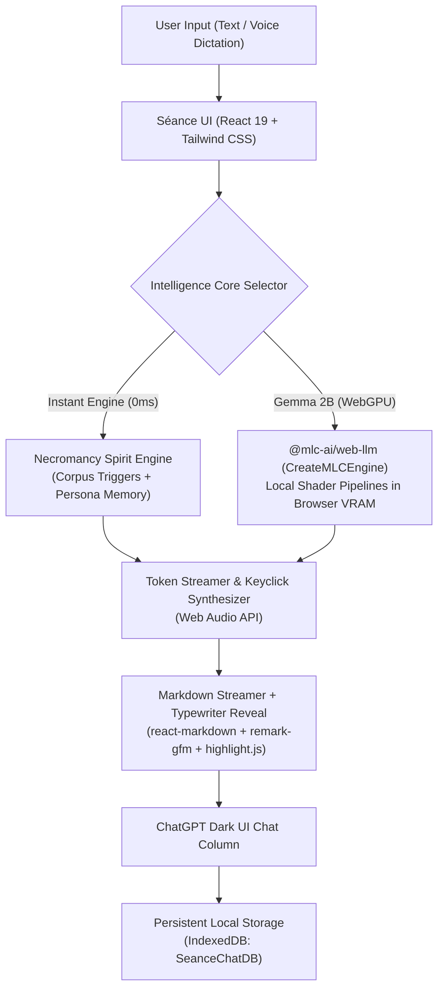

<div align="center">

# 🕯️ Séance

**An offline, in-browser séance channeling the spirits of computing history's greatest language ancestors.**

[](https://github.com/omshree59/Hecto---s-ance-chatbot)
[](#how-it-works)
[](LICENSE)
[](#getting-started)

<br />

<!-- Demo GIF / Screenshot Placeholder -->
<p align="center">
  
  <br />
  <em>The Séance interface channeling the spirit of PL/I (IBM System/360, 1964) with ChatGPT dark mode ergonomics.</em>
</p>

</div>

---

## Table of Contents

- [About](#about)
- [Features](#features)
- [How It Works](#how-it-works)
- [Tech Stack](#tech-stack)
- [Getting Started](#getting-started)
- [Usage](#usage)
- [Project Structure](#project-structure)
- [Adding a New Ancestor](#adding-a-new-ancestor)
- [Configuration](#configuration)
- [Roadmap](#roadmap)
- [Known Limitations](#known-limitations)
- [Contributing](#contributing)
- [License](#license)
- [Acknowledgements](#acknowledgements)
- [Recommended Screenshots to Capture](#recommended-screenshots-to-capture)

---

## About

**Séance** is an offline, client-side web application that reanimates the spirits of long-dead and foundational programming languages through a dark, ChatGPT-inspired conversational interface. As modern software engineering drifts toward high-level abstraction layers, the radical architectural philosophies, compiler breakthroughs, and syntactic idiosyncrasies of computing pioneers—such as PL/I's unreserved keywords, COBOL's strict division hierarchy, and FORTRAN's hardware-mapped arithmetic branches—risk being forgotten. 

Séance preserves and dramatizes this history by executing entirely within the user's web browser with zero external servers, telemetry, or remote API dependencies. Users can commune with language ancestors using either an instant, zero-latency rule-and-knowledge necromancy engine or a local neural LLM (Google Gemma 2B) running directly on their device's GPU via WebGPU.

---

## Features

- ⚡ **Dual Intelligence Engines**: Seamlessly toggle between the instant, deterministic Necromancy Engine (0 ms local latency) and in-browser neural inference powered by Google Gemma 2B via WebGPU.
- 🏛️ **Seven Language Ancestors**: Summon PL/I (1964), COBOL (1959), FORTRAN (1957), ALGOL 68 (1968), SNOBOL4 (1967), Plankalkül (1945), and INTERCAL (1972).
- 💾 **Persistent IndexedDB Storage**: Séances survive browser refreshes, offering full-text search across transcripts, in-place session renaming, and pinned conversations.
- 🖹 **IBM 5081 Punchcard Visualizer**: Inspect any code block or system transmission as an authentic 80-column Hollerith rectangular punch matrix.
- 📜 **The Grimoire & Historical Codex**: An interactive historical reference ledger with verified timeline dates, hardware specifications, and myth-busting annotations to guard against small-model hallucinations.
- 🎙️ **Voice Séance Mode**: Full-screen hands-free voice interface featuring live browser Speech-to-Text dictation and personalized pitch/cadence speech synthesis.
- 🔊 **Procedural Mechanical Audio**: Real-time Web Audio API synthesis generating persona-specific mechanical keypunch clicks, teletype thuds, relay pulses, and tape hiss without external media files.
- ✍️ **Complete Message Ergonomics**: Edit-and-resend previous user prompts, regenerate assistant replies, copy messages to clipboard, and export transcripts to Markdown (`.md`) or JSON (`.json`).
- 💡 **Dynamic Smart Chips**: Contextual prompt chips that evolve across conversation stages (Genesis $\to$ Syntax & Quirks $\to$ Modern Roasts $\to$ Legacy).
- 🕯️ **Victorian Dark Aesthetic**: Pure black (`#000000`) chamber canvas, `#171717` sidebar, glowing flame indicators, and period-authentic typography.

---

## How It Works

### Architecture Diagram



### Execution Flow

1. **Input Submission**: The user enters an inquiry via the auto-resizing composer or dictates speech using the browser's Web Speech API.
2. **Engine Routing**:
   - **Instant Mode**: Routed to `necromancyEngine.js`. Queries are evaluated against historical trigger corpora, semantic pattern matchers, and conversational persona memory (recalling past conversation topics).
   - **Gemma 2B Mode**: Routed to `gemmaEngine.js`. Formatted with the ancestor's system prompt and streamed through `@mlc-ai/web-llm` using client-side WebGPU shaders.
3. **Audio Accompaniment**: As tokens stream into the viewport, `seanceAudio.js` procedurally synthesizes keystroke acoustics specific to that ancestor's era (e.g., IBM 029 electric relay for PL/I, heavy mechanical teletype for COBOL, card punch perforation chunk for FORTRAN).
4. **Incremental Markdown & Typewriter Rendering**: Markdown syntax, tables, and fenced code blocks render smoothly. Opening stage directions (`*...*`) manifest with an authentic character-by-character typewriter reveal.
5. **Punchcard Encoding**: Code samples generate 80-column card deck indicators that can be opened in the interactive Hollerith punchcard simulator.
6. **Local Persistence**: Transcripts are automatically indexed in IndexedDB (`SeanceChatDB`), ensuring séances remain searchable and persistent across sessions.

---

## Tech Stack

| Layer | Technology | Version | Purpose |
| :--- | :--- | :--- | :--- |
| **Framework** | [React](https://react.dev/) | `^19.3.1` | Core declarative UI and reactive component state |
| **DOM Renderer** | [React DOM](https://react.dev/) | `^19.3.1` | Browser document mounting and portal management |
| **Build Tool** | [Vite](https://vite.dev/) | `^8.3.5` | Fast HMR development server and production bundler |
| **Styling** | [Tailwind CSS](https://tailwindcss.com/) | `^4.3.3` | Utility-first CSS styling and layout architecture |
| **Vite Plugin** | [@tailwindcss/vite](https://tailwindcss.com/) | `^4.3.3` | Direct Vite integration for Tailwind v4 |
| **Vite Plugin** | [@vitejs/plugin-react](https://github.com/vitejs/vite-plugin-react) | `^6.1.2` | Fast Refresh and JSX transformation |
| **Neural Runtime** | [@mlc-ai/web-llm](https://webllm.mlc.ai/) | `^0.2.86` | Client-side WebGPU inference for quantized Gemma 2B |
| **Markdown** | [react-markdown](https://github.com/remarkjs/react-markdown) | `^10.1.0` | Secure AST-based Markdown rendering |
| **Markdown GFM** | [remark-gfm](https://github.com/remarkjs/remark-gfm) | `^4.0.1` | Support for GFM tables, autolinks, and strikethroughs |
| **Code Highlighting**| [highlight.js](https://highlightjs.org/) | `^11.12.0` | Syntax highlighting for PL/I, COBOL, Fortran, and modern languages |
| **Iconography** | [lucide-react](https://lucide.dev/) | `^1.64.0` | Minimal dark-mode UI icons |
| **Visual Effects** | [canvas-confetti](https://github.com/catdad/canvas-confetti) | `^1.9.4` | Modal animations and chamber celebration effects |
| **Linter** | [oxlint](https://oxc-project.github.io/) | `^1.89.0` | High-performance Rust-based JavaScript/React linter |
| **Audio & Speech** | Web Audio API / Web Speech API | Native | 100% offline procedural sound and speech recognition |
| **Persistence** | IndexedDB API | Native | Client-side transactional storage with full-text search |

---

## Getting Started

### Prerequisites

- **Node.js**: Node.js `18.x` or later (tested on `v22.19.0`).
- **NPM**: NPM `9.x` or later (tested on `10.9.3`).
- **Web Browser**:
  - Any modern browser (Chrome, Firefox, Edge, Safari) runs the **Instant Engine**, audio synthesizer, and punchcard visualizer.
  - A browser with **WebGPU support** (Chrome 113+, Edge 113+) is required to run the **Gemma 2B** neural engine.
- **Hardware (Gemma 2B only)**:
  - Dedicated or integrated GPU with $\ge$ 4 GB of shared or dedicated memory.
  - Approximately **1.8 GB** of free browser CacheStorage space for the first-time model download.

### Installation

Clone the repository and install dependencies:

```bash
git clone https://github.com/omshree59/Hecto---s-ance-chatbot.git
cd dev5
npm install
```

### Running the Development Server

Start the local development server:

```bash
npm run dev
```

Open [http://localhost:5173](http://localhost:5173) in your browser.

### Building for Production

Compile production-ready static assets:

```bash
npm run build
```

The optimized output will be written to the `dist/` directory.

### Previewing the Production Build

Preview the production build locally:

```bash
npm run preview
```

### Running Code Quality Checks

Run Oxlint to check for linting issues:

```bash
npm run lint
```

---

## Usage

### 1. Selecting an Ancestor
Click the ancestor name in the top navigation bar (e.g., `PL/I (Instant) ▾`) or use the ancestor dropdown at the bottom of the sidebar to choose among the seven available entities:
- **PL/I**: The monolithic IBM System/360 giant with unreserved keywords.
- **COBOL**: The financial arch-bureaucrat with four divisions and Y2K survival lore.
- **FORTRAN**: The patriarch of scientific computing and the three-way arithmetic IF.
- **ALGOL 68**: The orthogonal sovereign of mathematical purity.
- **SNOBOL4**: The Bell Labs string and pattern transmutation alchemist.
- **Plankalkül**: Konrad Zuse's 1945 alpine grid language.
- **INTERCAL**: The 1972 Princeton satirical spoof.

### 2. Switching Intelligence Engines
Open the model picker dropdown from the top bar or sidebar:
- Select **Instant**: Responses generate deterministically with zero latency using historical trigger corpora.
- Select **Gemma 2B**: Triggers a one-time download of `gemma-2-2b-it-q4f16_1-MLC` into browser CacheStorage. WebGPU pipelines compile automatically and stream generated tokens in real time.

### 3. Consulting the Grimoire Codex
Click the **Codex** button in the sidebar to open the multi-chapter historical ledger. Select the **Historical Fact-Checker & Accuracy Ledger** tab to audit verified dates, designers, and hardware specifications or cross-reference debunked computing myths.

### 4. Example Prompts to Try

1. **PL/I (Paradox of Unreserved Keywords)**:
   > *"Explain how `IF IF THEN THEN = ELSE;` is lawful PL/I syntax, and demonstrate how your compiler parsed it without error."*

2. **COBOL (Monetary Precision & Y2K)**:
   > *"Demonstrate a payroll calculation using strict PICTURE clauses and explain how retired programmers averted disaster in the Year 2000 panic."*

3. **FORTRAN (Three-Way Arithmetic IF)**:
   > *"Show me an authentic FORTRAN routine utilizing the Three-Way Arithmetic IF and explain why modern supercomputers still depend on your non-aliasing arrays."*

---

## Project Structure

```
dev5/
├── docs/                             # Documentation assets and screenshots
│   └── demo.gif                      # Main demonstration GIF placeholder
├── public/                           # Static browser assets
│   ├── favicon.svg                   # Candle favicon
│   └── icons.svg                     # Web application icons
├── src/
│   ├── assets/                       # Static images and vector art
│   │   ├── hero.png                  # Landing graphic
│   │   ├── react.svg                 # React logo
│   │   └── vite.svg                  # Vite logo
│   ├── audio/
│   │   ├── seanceAudio.js            # Web Audio API synthesizer for keyclicks, hum, and tape hiss
│   │   └── seanceSpeech.js           # Text-to-Speech router with spirit pitch/rate and STT dictation
│   ├── components/
│   │   ├── ChatArea.jsx              # Main viewport, top bar, dynamic chips, and export triggers
│   │   ├── InputBar.jsx              # ChatGPT-style pill input with dictation and modal toggles
│   │   ├── LoreModal.jsx             # Grimoire Codex modal with verified historical facts
│   │   ├── MessageBubble.jsx         # Message bubble renderer, markdown, punchcard link, & typewriter effect
│   │   ├── PunchcardVisualizer.jsx   # 80-column IBM 5081 Hollerith punchcard card reader visualizer
│   │   ├── Sidebar.jsx               # ChatGPT-style dark sidebar with search, pin, rename, and core switch
│   │   └── VoiceModeModal.jsx        # Full-screen conversational voice séance modal
│   ├── db/
│   │   └── seanceDB.js               # IndexedDB manager for persistent sessions and full-text search
│   ├── engine/
│   │   ├── gemmaEngine.js            # WebLLM client-side WebGPU runner for Google Gemma 2B
│   │   └── necromancyEngine.js       # Offline knowledge base, persona memory, and smart suggestion engine
│   ├── App.css                       # Application layout styling
│   ├── App.jsx                       # Root application coordinator and session state manager
│   ├── index.css                     # Tailwind v4 imports, custom typography, and animation keyframes
│   └── main.jsx                      # React application entry point
├── .gitignore                        # Git ignore patterns
├── .oxlintrc.json                    # Oxlint rules configuration
├── index.html                        # HTML entry point with Inter and Fira Code fonts
├── package.json                      # Project dependencies, metadata, and scripts
└── vite.config.js                    # Vite configuration with React and Tailwind plugins
```

---

## Adding a New Ancestor

To introduce a new language ancestor (for example, **APL**, **LISP 1.5**, or **Simula 67**), follow these four steps:

### Step 1: Register Spirit Metadata in `src/engine/necromancyEngine.js`

Add an entry to the `SPIRITS` dictionary:

```javascript
export const SPIRITS = {
  // ... existing spirits
  apl: {
    id: 'apl',
    name: 'APL',
    fullName: 'A Programming Language (Ken Iverson)',
    title: 'The Matrix Sorcerer',
    era: '1962 — 1980s',
    sigil: '⍝',
    accentColor: '#38bdf8', // Cyan
    glowColor: 'rgba(56, 189, 248, 0.4)',
    fontFlavor: 'font-mono text-cyan-200/90',
    quote: '“Why write loops across pages when a single dimensional operator (⍳, ⍴, ⌽) transforms all tensors in one breath?”',
    compilerPrefix: 'APL62',
    introGreeting: `*A strange keyboard layout appears in the ectoplasm, etched with Greek glyphs and matrix arrows...*

**I AM APL.** Formulated by Kenneth E. Iverson in 1962.
I do not grovel before scalar loops. Bring me your vectors, your multidimensional arrays, and let us compute.`
  }
};
```

### Step 2: Define Knowledge Triggers & Responses

In `src/engine/necromancyEngine.js`, add a dedicated knowledge array and route it inside `handleOtherSpirits()` or `generateResponse()`:

```javascript
const APL_KNOWLEDGE = [
  {
    triggers: ['matrix', 'symbols', 'iverson', 'keyboard'],
    title: 'The Power of Iverson Notation',
    diagnostic: 'APL0001I: TENSOR DIMENSION COLLAPSED',
    punchcard: '      (⍳N) = (⍳N) ∘.× (⍳N)                                     APL00010',
    response: `In APL, we eliminated the verbosity of classical mathematics:

\`\`\`apl
⍝ Prime numbers up to R in a single expression:
(~R∊R∘.×R)/R←1↓ιR
\`\`\`

Where other languages required forty lines of nested DO-loops, I calculated the answer in twenty glyphs.`
  }
];
```

### Step 3: Add Era-Accurate Mechanical Typing Audio

In `src/audio/seanceAudio.js`, add a tailored synthesizer case in `playKeyClick(spiritId)`:

```javascript
case 'apl': {
  // IBM 2741 Selectric typewriter rotating golf-ball clatter
  osc.type = 'triangle';
  osc.frequency.setValueAtTime(450 + Math.random() * 80, now);
  gain.gain.setValueAtTime(0.03 * this.volume, now);
  gain.gain.exponentialRampToValueAtTime(0.0001, now + 0.045);
  osc.stop(now + 0.05);
  break;
}
```

### Step 4: Add Chapter to the Codex

In `src/components/LoreModal.jsx`, add a new chapter entry to `CHAPTERS` with verified historical details, principal designers, and design philosophies.

---

## Configuration

Séance runs **100% client-side** and does not require an external API key or `.env` configuration file. The default runtime constants can be adjusted in the following source files:

| Configuration Parameter | File Location | Default Value | Description |
| :--- | :--- | :--- | :--- |
| `GEMMA_MODEL_ID` | `src/engine/gemmaEngine.js` | `'gemma-2-2b-it-q4f16_1-MLC'` | WebLLM model identifier loaded via WebGPU |
| `temperature` | `src/engine/gemmaEngine.js` | `0.7` | Sampling temperature for Gemma 2B inference |
| `max_tokens` | `src/engine/gemmaEngine.js` | `1024` | Maximum tokens generated per Gemma response |
| `DB_NAME` | `src/db/seanceDB.js` | `'SeanceChatDB'` | IndexedDB database name |
| `DB_VERSION` | `src/db/seanceDB.js` | `1` | IndexedDB schema version |
| `manifestSpeed` | `src/App.jsx` | `'swift'` | Streaming interval (`whisper`: 45ms, `swift`: 28ms, `instant`: 0ms) |
| `candleIntensity` | `src/App.jsx` | `'Ritual'` | Visual candle flame intensity (`Subtle`, `Ritual`, `Blazing`) |
| `volume` | `src/audio/seanceAudio.js` | `0.35` | Default Web Audio master volume (range: 0.0 - 1.0) |

---

## Roadmap

- [x] **100% Offline Local Engine**: Rule-based knowledge base and compiler simulations.
- [x] **Client-side Neural LLM**: WebGPU inference via Google Gemma 2B (`@mlc-ai/web-llm`).
- [x] **ChatGPT Dark UI Ergonomics**: Column max-width, right-aligned user bubbles, and hover actions.
- [x] **Interactive IBM 5081 Punchcard Visualizer**: 80-column Hollerith zone matrix display.
- [x] **Procedural Audio Synthesizer**: Period-accurate mechanical keystrokes and binaural background hum.
- [x] **Voice Séance Mode**: Continuous Speech-to-Text dictation with spirit speech synthesis.
- [x] **IndexedDB Persistence**: Offline storage with full-text search, pin, and in-place rename.
- [x] **Export Options**: Download transcripts in Markdown (`.md`) and JSON (`.json`).
- [x] **Verified Grimoire Codex**: Anti-hallucination accuracy ledger with cross-referenced tables.
- [ ] **Multi-Model WebGPU Support**: Select between Gemma 2B, Llama 3.2 1B, and SmolLM in the UI.
- [ ] **Custom Punchcard File Export**: Download simulated punchcard decks as raw `.txt` / `.h80` files.
- [ ] **WebAssembly Mainframe Emulator**: Lightweight WASM-compiled emulator to execute valid subsets of PL/I and COBOL directly in the browser.

---

## Known Limitations

1. **Small-Model Hallucinations**:
   When using the local **Gemma 2B** neural engine, historical claims or syntax details may occasionally be conflated due to the parameter scale of 2B models. Cross-reference claims against the built-in **Historical Fact-Checker** tab in the Codex.
2. **WebGPU Hardware & Browser Requirement**:
   Neural inference with Gemma 2B requires a browser and operating system supporting WebGPU (Google Chrome 113+ or Microsoft Edge 113+ on Windows, macOS, or Linux). Browsers without WebGPU (such as older Safari versions or Firefox on certain platforms) will default automatically to the 0 ms **Instant Engine**.
3. **Initial Model Download Size**:
   Summoning Gemma 2B for the first time requires downloading approximately **1.8 GB** of quantized model weights into browser CacheStorage. Ensure you have an active network connection for the initial download; subsequent runs operate completely offline.
4. **Mobile Device Thermal Limits**:
   While the Instant Engine operates seamlessly on all mobile screens, WebGPU execution of Gemma 2B on mobile devices may encounter memory constraints or thermal throttling depending on the device's unified RAM.

---

## Contributing

Contributions from software historians, retrocomputing enthusiasts, and frontend engineers are welcome!

1. Fork the repository.
2. Create a feature branch:
   ```bash
   git checkout -b feature/new-language-ancestor
   ```
3. Commit your changes:
   ```bash
   git commit -m "feat: Add APL language ancestor and Selectric typing sound"
   ```
4. Push to the branch:
   ```bash
   git push origin feature/new-language-ancestor
   ```
5. Open a Pull Request.

Please ensure that any historical quotes, dates, or syntax samples are verified against primary literature (e.g., IBM Technical Manuals, ACM digital archives, or original language committee reports).

---

## License

This project is licensed under the **MIT License**. See the `LICENSE` file for details.

---

## Acknowledgements

- **Google DeepMind**: For releasing the open [Gemma](https://ai.google.dev/gemma) model weights.
- **MLC AI**: For the [@mlc-ai/web-llm](https://github.com/mlc-ai/web-llm) runtime enabling high-performance WebGPU client-side inference.
- **IBM & The SHARE/GUIDE Committee**: For the monument that was the IBM System/360 and the audacious vision of PL/I.
- **Rear Admiral Grace Hopper & CODASYL**: For pioneering human-readable data processing and compilers.
- **John Backus & The IBM 704 Team**: For demonstrating to the world that compiled code could rival handwritten assembly.

---

## Recommended Screenshots to Capture

To populate the documentation placeholders, capture and place the following assets into the `docs/` directory:

1. `docs/demo.gif`: An animated capture (or static screenshot) showing a conversation exchange with PL/I, highlighting the streaming response and Hollerith punchcard card link.
2. `docs/punchcard.png`: A screenshot of the **IBM 5081 Punchcard Visualizer** modal showing an 80-column line punched in Hollerith rectangular zone format.
3. `docs/voice-mode.png`: A screenshot of the full-screen **Voice Séance Mode** with pulsating ethereal speech waves.
4. `docs/codex.png`: A screenshot of the **Grimoire Codex** open to the *Historical Fact-Checker & Accuracy Ledger* table.
