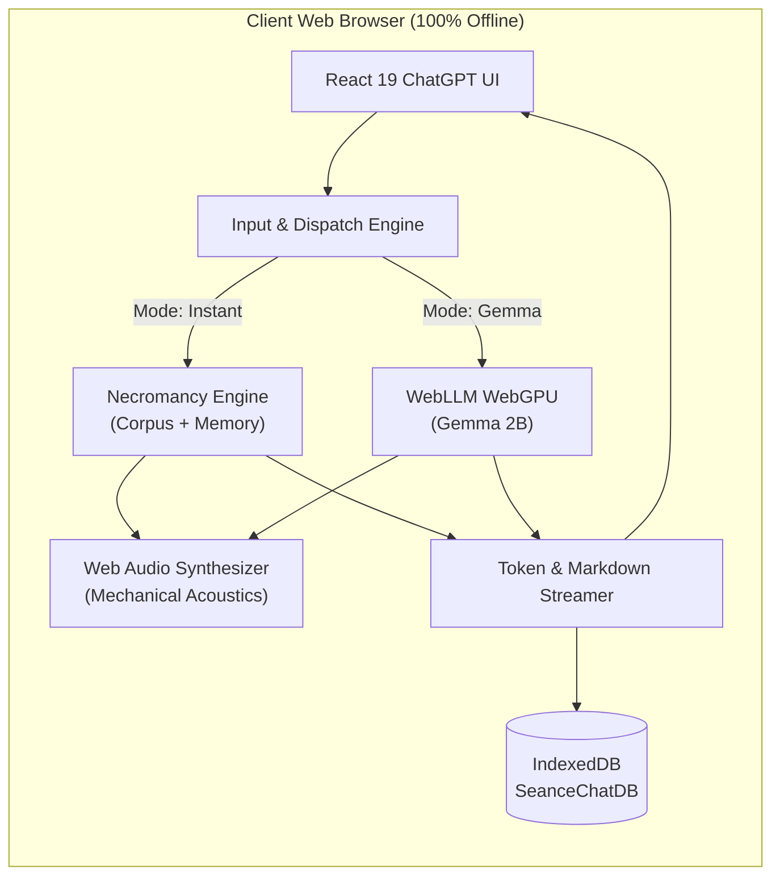

<div align="center">

# 🕯️ SÉANCE
### *The Offline Necromancy Chatbot for Long-Dead Programming Languages*

[](https://github.com/omshree59/Hecto---s-ance-chatbot)
[](#-dual-intelligence-engines)
[](#-dual-intelligence-engines)
[](#-ui--experience-showcase)
[](#-key-capabilities)

<br />

```
╔════════════════════════════════════════════════════════════════════════════════════════════╗
║  "I held neither fear nor moderation: I had no reserved keywords, I commanded             ║
║   multitasking before operating systems possessed it, and my structured ON-conditions     ║
║   trapped the errors of the cosmos." — PL/I (IBM System/360, 1964)                         ║
╚════════════════════════════════════════════════════════════════════════════════════════════╝
```

<br />

<!-- PREVIEW HERO FRAME -->
<p align="center">
  <a href="#-quickstart">
    
  </a>
</p>

<p align="center">
  <b>Commune with the ancient ancestors of silicon. 100% client-side, zero cloud telemetry, instant offline necromancy.</b>
</p>

---

### ⚡ 60-Second Quickstart

```bash
# Clone the repository
git clone https://github.com/omshree59/Hecto---s-ance-chatbot.git

# Enter workspace and install dependencies
cd dev5
npm install

# Launch the offline development chamber
npm run dev
```

</div>

<br />

---

## 📑 Contents

- [✨ Why Séance?](#-why-séance)
- [📸 UI & Experience Showcase](#-ui--experience-showcase)
- [⚡ Dual Intelligence Engines](#-dual-intelligence-engines)
- [🏛️ The Ancestor Pantheon](#️-the-ancestor-pantheon)
- [⚙️ Architecture & How It Works](#️-architecture--how-it-works)
- [📊 Feature Comparison](#-feature-comparison)
- [🛠️ Tech Stack](#️-tech-stack)
- [🚀 Quickstart & Scripts](#-quickstart--scripts)
- [🖹 Interactive Punchcard Visualizer](#-interactive-punchcard-visualizer)
- [📜 Historical Codex & Anti-Hallucination Ledger](#-historical-codex--anti-hallucination-ledger)
- [🔊 Procedural Web Audio Synthesizer](#-procedural-web-audio-synthesizer)
- [🧱 Adding a New Ancestor](#-adding-a-new-ancestor)
- [⚙️ Configuration Constants](#️-configuration-constants)
- [🗺️ Roadmap](#️-roadmap)
- [⚠️ Known Limitations](#️-known-limitations)
- [🤝 Contributing & License](#-contributing--license)

---

## ✨ Why Séance?

As modern software development abstracts into microservices, virtual DOMs, and cloud runtimes, the radical design decisions that forged computing history are rapidly slipping into mythology.

**Séance** is an offline digital necromancy chamber built as a high-fidelity pair-programming assistant and historical artifact. It resurrects the legendary language ancestors of computing history—beginning with **PL/I (1964)** on the monument that was the **IBM System/360**, through **COBOL (1959)** and **FORTRAN (1957)** to **Plankalkül (1945)**.

| The Problem | The Séance Solution |
| :--- | :--- |
| **Remote AI Dependency** — Modern chatbots require constant network connections, send private code to third-party cloud servers, and suffer latency spikes. | **100% Client-Side Air-Gapped** — Runs entirely inside your browser sandbox via WebGPU and zero-latency local rule engines. Zero data leaves your machine. |
| **Historical Amnesia** — Generative AI models regularly hallucinate early computing specs (e.g., claiming PL/I had reserved words or conflating Grace Hopper's role in COBOL). | **Historical Fact-Checker & Accuracy Ledger** — Integrated primary-source codex verifying dates, committee reports, and hardware constraints. |
| **Flat, Emotionless AI UIs** — Generic chatbots strip away period acoustics, mechanical tactile feedback, and authentic design aesthetics. | **Period Mechanical Acoustics & Artifacts** — Procedural Web Audio relay clicks, card punch chunks, teletype clatter, and authentic 80-column Hollerith punchcards. |

---

## 📸 UI & Experience Showcase

<div align="center">
<table>
  <tr>
    <td width="50%" align="center">
      <b>💬 ChatGPT Dark UI Ergonomics</b><br />
      <sub>Pure black (#000000) canvas, #171717 sidebar, auto-growing composer pill, and hover message actions.</sub>
    </td>
    <td width="50%" align="center">
      <b>🖹 80-Column Hollerith Punchcard Reader</b><br />
      <sub>Inspect any generated code or transmission as a real-time IBM 5081 rectangular punchcard matrix.</sub>
    </td>
  </tr>
  <tr>
    <td width="50%" align="center">
      <b>🎙️ Full-Screen Voice Séance Mode</b><br />
      <sub>Hands-free conversational mode featuring continuous STT dictation and persona-specific acoustic TTS.</sub>
    </td>
    <td width="50%" align="center">
      <b>📜 The Grimoire Codex & Fact-Checker</b><br />
      <sub>Cross-referenced historical specs from IBM Technical Reports, ACM digital archives, and IEEE annals.</sub>
    </td>
  </tr>
</table>
</div>

### Interactive Terminal Preview Mockup

```
┌─── SÉANCE CHAMBER ────────────────────────────────────────────────────────────────────────┐
│ [⚚ PL/I (Instant) ▾]                          🕯️ [Voice Mode]  [+ New Séance]  [...]       │
├───────────────────────────────────────────────────────────────────────────────────────────┤
│                                                                                           │
│  Medium: "Explain the paradox of having no reserved keywords in PL/I with an example."    │
│                                                                                           │
│  ⚚ PL/I [IBM0411I: PARSER ATTEMPTING AMBIGUOUS SYMBOL RESOLUTION]                         │
│  *A sudden draft chills the chamber. The magnetic reels of an IBM 2401 begin to spin...*  │
│                                                                                           │
│  Ah, you speak of my greatest and most terrible liberty: I HAD ZERO RESERVED KEYWORDS.    │
│  The IBM and SHARE decree was absolute: a programmer's variable names must never break.   │
│                                                                                           │
│  ```pli                                                                                   │
│  /* Valid, compilable PL/I syntax: */                                                     │
│  SPECTRAL_SEANCE: PROC OPTIONS(MAIN);                                                     │
│      DCL (IF, THEN, ELSE) FIXED DECIMAL(5);                                               │
│      IF IF = THEN THEN THEN = ELSE; ELSE ELSE = THEN;                                     │
│  END SPECTRAL_SEANCE;                                                                     │
│  ```                                                                                      │
│                                                                                           │
│  [Card: 000100 IF IF THEN THEN = ELSE; ELSE ELSE = THEN; PLI00010]  [Copy] [Regenerate]   │
└───────────────────────────────────────────────────────────────────────────────────────────┘
```

---

## ⚡ Dual Intelligence Engines

Séance equips you with two distinct, complementary cognitive cores selectable with a single click:

```
                  ┌──────────────────────────────────────────────┐
                  │          USER PROMPT / VOICE INPUT           │
                  └──────────────────────┬───────────────────────┘
                                         ▼
                        ┌─────────────────────────────────┐
                        │   INTELLIGENCE CORE SELECTOR    │
                        └────────┬───────────────┬────────┘
                                 │               │
                 [ Instant Engine ]             [ Gemma 2B WebGPU ]
                                 │               │
                                 ▼               ▼
        ┌────────────────────────────────┐  ┌────────────────────────────────┐
        │  Necromancy Spirit Engine      │  │  @mlc-ai/web-llm (WebGPU)      │
        │  • 0ms deterministic latency   │  │  • Google Gemma 2B Instruct    │
        │  • Semantic historical triggers│  │  • 4-bit Quantized (q4f16_1)   │
        │  • Persona memory callbacks    │  │  • In-browser shader pipelines │
        │  • Procedural diagnostics      │  │  • 100% offline neural weights │
        └────────────────┬───────────────┘  └────────────────┬───────────────┘
                         │                                   │
                         └─────────────────┬─────────────────┘
                                           ▼
                  ┌──────────────────────────────────────────────┐
                  │    TOKEN STREAMER + PROCEDURAL KEYCLICKS     │
                  │   Typewriter reveal & Web Audio acoustics    │
                  └──────────────────────┬───────────────────────┘
                                         ▼
                  ┌──────────────────────────────────────────────┐
                  │    INDEXEDDB STORAGE & MARKDOWN RENDERING    │
                  └──────────────────────────────────────────────┘
```

### Engine Comparison Matrix

| Capability | ⚡ Instant Necromancy Engine | 🧠 Gemma 2B WebGPU Core |
| :--- | :--- | :--- |
| **Model Architecture** | Scripted Semantic Graph + Persona Memory | Neural Decoder LLM (`gemma-2-2b-it-q4f16_1-MLC`) |
| **Response Latency** | **$<$ 1 ms** (Instantaneous) | Real-time token streaming via GPU shaders |
| **Hardware Requirement**| Any device (even low-power smartphones) | GPU with WebGPU support ($\ge$ 2GB VRAM recommended) |
| **Initial Download Size**| **0 bytes** (Packaged inside bundle) | ~1.8 GB (one-time browser cache download) |
| **Offline Reliability** | 100% deterministic & guaranteed | 100% offline once model weights are cached |
| **Primary Specialty** | Authentic historical facts, code templates, roasts | Open-ended emergent roleplay & creative queries |

---

## 🏛️ The Ancestor Pantheon

Séance features seven fully realized silicon ancestors, each equipped with period-specific system prompts, color themes, typing acoustics, and authentic historical lore:

```
┌──────────────┬───────────────────┬───────────────────────────────────────────┬──────────────┐
│ Sigil & Name │ Era               │ Historical Persona Title                  │ Accent Color │
├──────────────┼───────────────────┼───────────────────────────────────────────┼──────────────┤
│ ⚚  PL/I      │ 1964 — Circa 1985 │ The Monolithic Leviathan (IBM S/360)      │ #f59e0b Gold │
│ 🏛️  COBOL     │ 1959 — Immortal   │ The Ledger Arch-Bureaucrat (Grace Hopper) │ #22c55e Green│
│ 📐 FORTRAN   │ 1957 — Immortal   │ The Patriarch of Silicon (John Backus)    │ #fb923c Amber│
│ ☿  ALGOL 68  │ 1968 — Circa 1982 │ The Orthogonal Sovereign (van Wijngaarden)│ #10b981 Mint │
│ 🜂  SNOBOL4   │ 1967 — Circa 1978 │ The Pattern Alchemist (Bell Laboratories) │ #c084fc Purple│
│ ⚙  Plankalkül│ 1942 — 1945       │ The Primordial Ghost (Konrad Zuse)        │ #38bdf8 Cyan │
│ 🃏 INTERCAL  │ 1972 — Beyond     │ The Eldritch Jester (Princeton Parody)    │ #f43f5e Rose │
└──────────────┴───────────────────┴───────────────────────────────────────────┴──────────────┘
```

<details>
<summary><b>🔍 Expand Ancestor Bios & Quirk Details</b></summary>
<br />

### 1. ⚚ PL/I (Programming Language One)
- **Year & Hardware**: 1964 • IBM System/360 Mainframe.
- **Historic Gamble**: Thomas Watson Jr. wagered \$5 billion on a unified computing architecture for both science and business.
- **Eldritch Quirk**: **Zero reserved keywords**. `IF IF THEN THEN = ELSE;` was completely legal.
- **Acoustic Profile**: IBM 029 electric keypunch relay click (`320Hz–450Hz` square wave pulse).

### 2. 🏛️ COBOL (Common Business-Oriented Language)
- **Year & Hardware**: 1959 • IBM 1401, UNIVAC II, IBM System/360.
- **Pioneers**: CODASYL committee and Rear Admiral Grace Hopper.
- **Immortal Reality**: Powers an estimated \$3 trillion daily in banking, ATM networks, and automated clearing houses.
- **Acoustic Profile**: Resonant mechanical teletype clack (`170Hz–220Hz` triangle wave impact).

### 3. 📐 FORTRAN (Formula Translating System)
- **Year & Hardware**: 1957 • Vacuum-tube IBM 704.
- **Pioneers**: John Backus and the IBM 704 team.
- **Historic Victory**: Proved compiled high-level formulas could achieve 90% of hand-written assembly speed.
- **Eldritch Quirk**: **Three-Way Arithmetic IF** (`IF (X - Y) 10, 20, 30`) and strict column 1–72 card discipline.
- **Acoustic Profile**: IBM 026 card punch perforation chunk (`220Hz–290Hz` sawtooth chunk).

### 4. ☿ ALGOL 68 (Algorithmic Language 1968)
- **Year & Hardware**: 1968 • Electrologica X8, ICL 1900.
- **Pioneers**: Adriaan van Wijngaarden and IFIP Working Group 2.1.
- **Eldritch Quirk**: Specified via a two-level *W-grammar*. Every mode and operator was strictly orthogonal.

### 5. 🜂 SNOBOL4 (StriNg Oriented and Symbolic Language 4)
- **Year & Hardware**: 1967 • Bell Telephone Laboratories (Farber, Griswold, Polonsky).
- **Eldritch Quirk**: First-class recursive pattern matching decades before modern PCRE regular expressions.

### 6. ⚙ Plankalkül (Plan Calculus)
- **Year & Hardware**: 1942–1945 • Bavarian Alps (Konrad Zuse).
- **Eldritch Quirk**: World's first high-level language, drafted in pencil during WWII; 2D multi-tier matrix syntax.

### 7. 🃏 INTERCAL (Compiler Language With No Pronounceable Acronym)
- **Year & Hardware**: 1972 • Princeton University (Don Woods & Jim Lyon).
- **Eldritch Quirk**: `COME FROM` statement, `PLEASE` politeness checks (`IC-079E: PROGRAMMER IS INSUFFICIENTLY POLITE`).

</details>

---

## ⚙️ Architecture & How It Works



### Execution Flow in 5 Steps:
1. **User Interaction**: Prompts are submitted via keyboard or live dictation through the browser's native `SpeechRecognition` API.
2. **Context & Persona Memory**: In Instant Mode, `necromancyEngine.js` scans previous conversation turns for keywords (e.g., Python, recursion, payroll, Y2K) and injects contextual memory callbacks into the response.
3. **Hardware-Accelerated WebGPU**: In Gemma Mode, `@mlc-ai/web-llm` compiles quantized weights (`gemma-2-2b-it-q4f16_1-MLC`) directly into GPU shader pipelines on device.
4. **Procedural Keystroke Audio**: While tokens stream into the markdown viewport, `seanceAudio.js` triggers percussive oscillator pulses reflecting the mechanical hardware of that language's era.
5. **Permanent Persistence**: The session is asynchronously synchronized with `SeanceChatDB` in IndexedDB, supporting instant full-text search, pin, and rename operations.

---

## 📊 Feature Comparison

| Feature | Standard Cloud Chatbots | Typical Retro Simulators | 🕯️ Séance |
| :--- | :---: | :---: | :---: |
| **100% Offline Capability** | ❌ No | ⚠️ Partial | ✅ **100% In-Browser** |
| **Privacy (Zero External Calls)**| ❌ Cloud Logs | ⚠️ Varies | ✅ **Zero Telemetry** |
| **Dual Engine (0ms + Neural LLM)**| ❌ Single Engine | ❌ Scripted Only | ✅ **Instant + Gemma 2B** |
| **Mechanical Keystroke Acoustics**| ❌ Silent | ⚠️ Static MP3s | ✅ **Web Audio Procedural** |
| **Hollerith 80-Col Punchcard View**| ❌ None | ❌ None | ✅ **Interactive Matrix** |
| **Historical Accuracy Ledger** | ❌ Hallucinates | ❌ Rare | ✅ **Integrated Codex** |
| **ChatGPT Dark UI Ergonomics** | ✅ Yes | ❌ Clunky | ✅ **Pure Black #000** |
| **Persistent Searchable Storage** | ⚠️ Server-Bound | ❌ In-Memory | ✅ **IndexedDB Full-Text**|
| **Hands-Free Voice Mode** | ⚠️ Subscription | ❌ None | ✅ **Free Native STT/TTS**|

---

## 🛠️ Tech Stack

```
dev5/
├── Frontend Core      React 19.3.1  •  React DOM 19.3.1  •  Vite 8.3.5
├── Styling & Fonts    Tailwind CSS 4.3.3  •  Inter  •  Fira Code  •  Cinzel
├── Neural AI Runtime  @mlc-ai/web-llm 0.2.86 (WebGPU Client Inference)
├── Markdown & Code    react-markdown 10.1.0  •  remark-gfm 4.0.1  •  highlight.js 11.12.0
├── Audio & Speech     Web Audio API (Procedural Oscillators)  •  Web Speech API
├── Local Database     IndexedDB API (Database: SeanceChatDB, Store: sessions)
└── Quality & Linter   Oxlint 1.89.0
```

---

## 🚀 Quickstart & Scripts

### Prerequisites
- **Node.js**: `18.x` or later (verified on `v22.19.0`).
- **NPM**: `9.x` or later (verified on `10.9.3`).
- **Browser**: Modern Chromium browser (Chrome 113+, Edge 113+) recommended for WebGPU mode.

### Commands

```bash
# 1. Install all dependencies
npm install

# 2. Start local development server with Hot Module Replacement (HMR)
npm run dev

# 3. Build optimized production bundle
npm run build

# 4. Preview the production build locally
npm run preview

# 5. Run lightning-fast Oxlint checks
npm run lint
```

---

## 🖹 Interactive Punchcard Visualizer

Séance features a full simulator of the legendary **IBM 5081 standard 80-column punchcard**. Every code sample generated in chat includes a `Card: ...` inspection button.

```
       0         1         2         3         4         5         6         7         
Column:12345678901234567890123456789012345678901234567890123456789012345678901234567890
Text:  000100 IF IF THEN THEN = ELSE; ELSE ELSE = THEN;                   PLI00010
       ┌──────────────────────────────────────────────────────────────────────────────┐
Row 12 │ [ ]                                                                          │
Row 11 │       [ ]                     [ ]                                            │
Row 0  │                                                                              │
Row 1  │ [X] [X] [X]                                                                  │
Row 2  │                                                                              │
Row 3  │                                                                              │
...    │                                                                              │
       └──────────────────────────────────────────────────────────────────────────────┘
```

- **Columns 1–72**: The sacred territory of program statements.
- **Columns 73–80**: The card sequence identification numbers (preventing disaster if a deck was dropped on the computing center floor).

---

## 📜 Historical Codex & Anti-Hallucination Ledger

Small 2B models can inadvertently conflate historical timelines. The **Grimoire Codex** contains verified primary-source records directly accessible in the UI:

```
┌──────────────┬──────┬────────────────────────┬───────────────────┬───────────────────────────────────────────────┐
│ Language     │ Year │ Primary Designers      │ Target Platform   │ True Historical Status                        │
├──────────────┼──────┼────────────────────────┼───────────────────┼───────────────────────────────────────────────┤
│ FORTRAN      │ 1957 │ John Backus & IBM Team │ IBM 704           │ Essential: Powers ECMWF & NOAA weather models │
│ COBOL        │ 1959 │ CODASYL (Grace Hopper) │ IBM 1401, S/360   │ Immortal: Transacts ~$3T daily in banking     │
│ PL/I         │ 1964 │ George Radin & SHARE   │ IBM System/360    │ Legacy: Maintained in enterprise insurance    │
│ ALGOL 68     │ 1968 │ IFIP Working Group 2.1 │ Electrologica X8  │ Ancestral: Ancestor of Haskell, Ada, & Rust   │
│ SNOBOL4      │ 1967 │ Farber, Griswold, et al│ IBM 7090, PDP-10  │ Extinct: Evolved into Icon and modern regex   │
│ Plankalkül   │ 1945 │ Konrad Zuse            │ Zuse Z3/Z4 Paper  │ Historic: First compiled in 1998 (FU Berlin)  │
│ INTERCAL     │ 1972 │ Don Woods & Jim Lyon   │ IBM 360/91        │ Cult Classic: Founded the esolang movement    │
└──────────────┴──────┴────────────────────────┴───────────────────┴───────────────────────────────────────────────┘
```

---

## 🔊 Procedural Web Audio Synthesizer

Séance does not load bulky static audio files over the network. Instead, [`src/audio/seanceAudio.js`](file:///d:/CODE79HACK%20WEB%20DEV%20SECRET%20HACK%20SIGMA/dev5/src/audio/seanceAudio.js) generates analog acoustics mathematically using the Web Audio API:

- **Binaural Drone**: Twin sine wave oscillators tuned to `432 Hz` and `436 Hz` create an ethereal `4 Hz` delta wave chamber tone.
- **Mainframe Tape Hiss**: Procedurally calculated white noise buffer filtered through a `1200 Hz` bandpass filter.
- **Persona Keyclicks**:
  - *PL/I*: Square-wave keypunch relay click (`320 Hz` exponential decay).
  - *COBOL*: Deep resonant teletype impact (`170 Hz` triangle oscillator).
  - *FORTRAN*: Sawtooth card punch perforation chunk (`220 Hz`).
  - *Plankalkül*: Low metallic telephone relay pulse (`130 Hz`).
  - *INTERCAL*: Pitch-randomized chaotic typewriter plink (`180 Hz - 900 Hz`).

---

## 🧱 Adding a New Ancestor

You can add a custom programming language ancestor in three simple steps:

### 1. Register Metadata in `src/engine/necromancyEngine.js`

```javascript
export const SPIRITS = {
  // ...
  apl: {
    id: 'apl',
    name: 'APL',
    fullName: 'A Programming Language (Ken Iverson)',
    title: 'The Matrix Sorcerer',
    era: '1962 — 1980s',
    sigil: '⍝',
    accentColor: '#38bdf8',
    glowColor: 'rgba(56, 189, 248, 0.4)',
    fontFlavor: 'font-mono text-cyan-200/90',
    quote: '“Why write loops across pages when a single operator (⍳, ⍴, ⌽) transforms all tensors?”',
    compilerPrefix: 'APL62',
    introGreeting: `*A Selectric typewriter golf ball rotates in the dark, etched with Greek glyphs...*`
  }
};
```

### 2. Add Era Mechanical Sound in `src/audio/seanceAudio.js`

```javascript
case 'apl': {
  // IBM 2741 Selectric typewriter mechanical clatter
  osc.type = 'triangle';
  osc.frequency.setValueAtTime(450 + Math.random() * 80, now);
  gain.gain.setValueAtTime(0.03 * this.volume, now);
  gain.gain.exponentialRampToValueAtTime(0.0001, now + 0.045);
  osc.stop(now + 0.05);
  break;
}
```

### 3. Add Verified Specs to `src/components/LoreModal.jsx`
Insert an entry into `CHAPTERS` with verified designers, historical context, and hardware specs.

---

## ⚙️ Configuration Constants

| Setting | Location | Default | Description |
| :--- | :--- | :--- | :--- |
| `GEMMA_MODEL_ID` | `src/engine/gemmaEngine.js` | `'gemma-2-2b-it-q4f16_1-MLC'` | WebLLM model identifier |
| `temperature` | `src/engine/gemmaEngine.js` | `0.7` | Sampling temperature for Gemma 2B |
| `max_tokens` | `src/engine/gemmaEngine.js` | `1024` | Maximum tokens per neural response |
| `DB_NAME` | `src/db/seanceDB.js` | `'SeanceChatDB'` | Local IndexedDB database store name |
| `manifestSpeed` | `src/App.jsx` | `'swift'` | Streaming interval (`whisper`: 45ms, `swift`: 28ms, `instant`: 0ms) |
| `candleIntensity` | `src/App.jsx` | `'Ritual'` | Visual flame aura intensity (`Subtle`, `Ritual`, `Blazing`) |
| `volume` | `src/audio/seanceAudio.js` | `0.35` | Master audio volume (range: 0.0 to 1.0) |

---

## 🗺️ Roadmap

- [x] **100% Offline Local Engine**: Deterministic semantic corpus + compiler diagnostics.
- [x] **Client-Side WebGPU Neural LLM**: Google Gemma 2B running via `@mlc-ai/web-llm`.
- [x] **ChatGPT Dark UI Ergonomics**: Clean column layout, auto-growing composer, hover action rows.
- [x] **IBM 5081 Hollerith Punchcard Visualizer**: Interactive 80-column punchcard reader.
- [x] **Procedural Web Audio Engine**: Era-specific mechanical keyclatter & binaural drone.
- [x] **Hands-Free Voice Séance**: Native browser continuous STT dictation and persona TTS.
- [x] **IndexedDB Persistence**: Offline database with full-text search, pinning, and in-place renaming.
- [x] **Dual Export Formats**: Markdown (`.md`) and JSON (`.json`) transcript downloads.
- [x] **Verified Grimoire Codex**: Anti-hallucination accuracy ledger with debunked myths.
- [ ] **Multi-Model WebGPU Support**: Select between Gemma 2B, Llama 3.2 1B, and Qwen 2.5 Coder.
- [ ] **Raw Punchcard Deck Export**: Download simulated punchcards as `.h80` / raw text decks.
- [ ] **Browser WASM Emulator**: Execute a verified subset of PL/I and COBOL in client WebAssembly.

---

## ⚠️ Known Limitations

1. **Small-Model Hallucinations**:
   When using the neural **Gemma 2B** core, historical claims may occasionally be conflated due to the parameter scale of 2B models. Use the integrated **Codex Fact-Checker** to verify claims.
2. **WebGPU Hardware Support**:
   Neural inference with Gemma 2B requires a modern browser supporting WebGPU (Chrome 113+, Edge 113+). Devices without WebGPU automatically default to the 0 ms **Instant Necromancy Engine**.
3. **First-Time Download Size**:
   Summoning Gemma 2B requires downloading ~1.8 GB of quantized model weights into browser `CacheStorage` on the first run. Subsequent invocations work completely offline.

---

## 🤝 Contributing & License

Contributions, historical corrections, and new ancestor submissions are welcomed!

```bash
git checkout -b feature/new-ancestor
git commit -m "feat: Add APL language ancestor"
git push origin feature/new-ancestor
```

Distributed under the **MIT License**. See `LICENSE` for details.

### Acknowledgements
- **Google DeepMind** for the open [Gemma](https://ai.google.dev/gemma) model architecture.
- **The MLC AI Team** for the groundbreaking [@mlc-ai/web-llm](https://github.com/mlc-ai/web-llm) client runtime.
- **IBM & The SHARE Committee** for the daring vision of the System/360 and PL/I.
- **Rear Admiral Grace Hopper & John Backus** for daring to believe computers could speak human language.

---

<div align="center">
  <sub>Séance • Crafted with reverence for the lost cathedrals of computing history.</sub>
</div>
